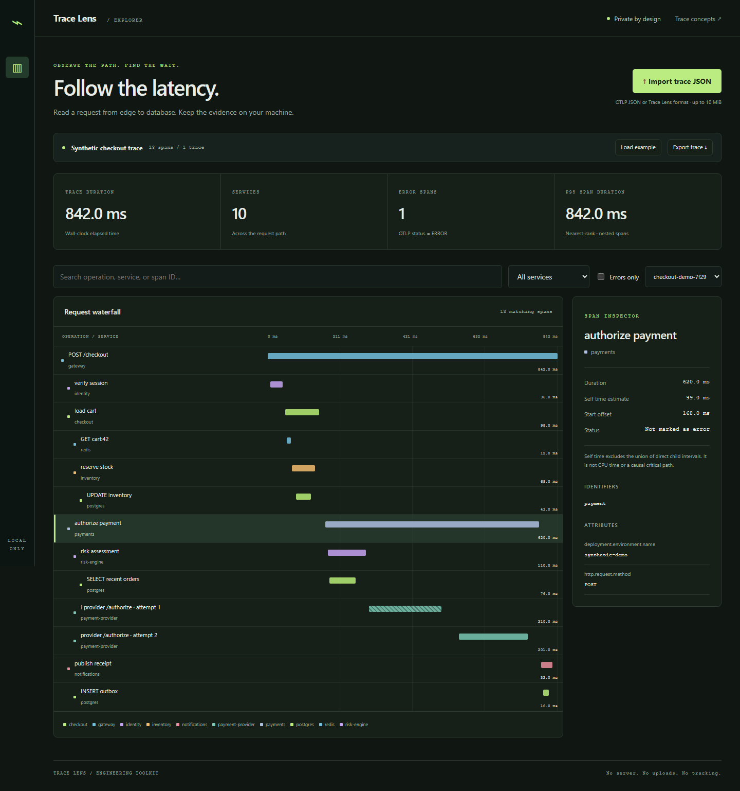

# Trace Lens

[](https://github.com/nazek52/trace-lens/actions/workflows/ci.yml)

An offline-first trace explorer for investigating latency without sending trace data to a server. Import OTLP JSON, inspect a nested waterfall, find error spans, and export a normalized trace.

**TypeScript · React · Web Workers · timing algorithms · Playwright**



[Русский разбор](docs/INTERVIEW.ru.md) · [Architecture](docs/architecture.md) · [Verification](docs/verification.md)

## Run

Node.js 24 and npm. No account, API key, database, or backend is needed.

```sh
npm ci
npm run dev
```

Open the local URL printed by Vite. The initial checkout trace is clearly labeled **synthetic**. Import your own JSON using the import button. The application performs no uploads, analytics calls, or remote font requests. After assets have loaded, trace operations are local; it does not install a service worker or promise offline page reloads.

```sh
npm test
npm run build
npx playwright install chromium
npm run test:e2e
```

## Implemented capabilities

- OTLP `resourceSpans[].scopeSpans[].spans[]` import and a small documented normalized format.
- Parsing and validation in a disposable Web Worker. Failed imports preserve the previous trace; stale parsing results cannot replace newer files.
- BigInt subtraction before converting nanoseconds to relative milliseconds avoids loss of low-order timestamp precision.
- Parent-cycle and duplicate-ID rejection, orphan and clock-skew warnings, and iterative rendering for deep trees.
- Trace/service/text/error filters, 100 rows per page, responsive layout, keyboard-operable rows, and accessible control labels.
- Self-time estimate subtracts the **union** of direct-child intervals, so overlapping children are not double counted.
- Download the selected trace and re-import it without a network request.

## Data contract

Input is limited to 10MiB and 10,000 spans. A normalized export has this shape:

```json
{"spans":[{"id":"root","traceId":"trace-1","name":"GET /orders","service":"api","start":0,"duration":20,"error":false,"attributes":{"environment":"synthetic"}}]}
```

`parentId` is optional. Times are nonnegative milliseconds; attributes are string values. IDs are unique within a trace. OTLP timestamp fields must be decimal integer strings. OTLP resource service names are read from `service.name`; complex attribute values are summarized. This is a supported subset, not a complete OTLP collector or protocol validator.

## Interpretation limits

Span p95 summarizes nested span durations, **not request p95**. Self time is not CPU time or a causal critical path. Missing instrumentation, asynchronous operations, and clock skew can change interpretation. The UI flags out-of-parent timing instead of silently correcting data. Color identifies a service but labels remain the primary identifier. No private trace content is persisted by the application.

The parser tests cover a 10,000-deep tree, overlapping children, malformed imports, and nanosecond precision. Browser tests exercise import/export, worker failures, filtering, mobile overflow, keyboard focus, and runtime errors. [OpenTelemetry trace concepts](https://opentelemetry.io/docs/concepts/signals/traces/) describe the underlying model.

Personal, AI-assisted engineering project; [MIT](LICENSE).
